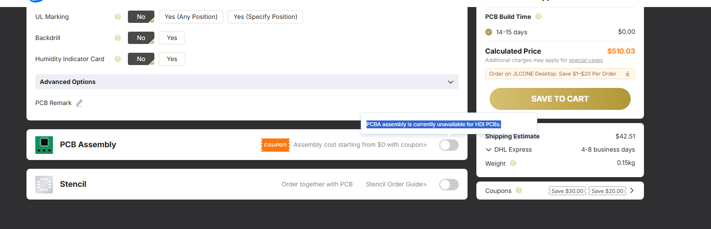
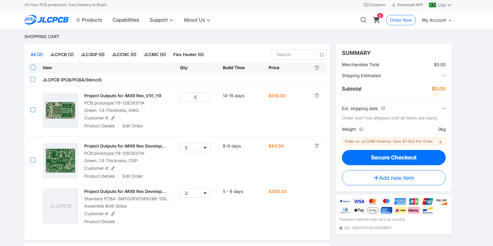

# Cotação JLCPCB — fabricação e montagem

Registro das capturas fornecidas pelo aluno. Os nomes dos arquivos de origem indicam **12/10/2026**; essa data não está comprovada pelo conteúdo da página. Moeda: **USD**. Os valores representam a simulação exibida, sem comprovação de pagamento ou pedido concluído.

## Itens do carrinho

| Item | Identificação visível | Qtd. | Prazo exibido | Valor do item |
|---|---|---:|---|---:|
| PCB do módulo | Project Outputs for iMX6 Rex_V1I1_Y9 / Y9-12828371A | 5 | 14–15 dias | US$ 510,03 |
| PCB da placa base | Project Outputs for iMX6 Rex Develop… / Y8-12828371A | 5 | 8–9 dias | US$ 43,50 |
| PCBA da placa base | Standard PCBA: SMT026101306286-128… | 2 | 5–6 dias | US$ 330,53 |
| **Soma dos três valores** | | | | **US$ 884,06** |

Os textos terminados em “…” estão cortados na captura. Os prazos são os mostrados para cada item; a imagem não explica se fabricação e montagem ocorrem sequencialmente.

- **Módulo:** máscara verde, espessura de 1,6 mm e acabamento ENIG.
- **Placa base:** máscara verde, espessura de 1,6 mm e acabamento OSP.
- **Montagem da base:** dois lados, lote de 2 placas. A compra de PCB é de 5 unidades; o print não indica montagem de todas as cinco.
- **Frete na tela do módulo:** US$ 42,51, DHL Express, 4–8 dias úteis, peso estimado de 0,15 kg. Não há evidência de que cubra todos os itens do carrinho.

## Atendimento ao pedido de montagem na fábrica

A opção de montagem está demonstrada para a **placa base**, com a linha “Assemble Both Sides”. Na tela do **módulo**, o aviso informa: “PCBA assembly is currently unavailable for HDI PCBs.” O botão de montagem está desativado.

Assim, os prints registram a tentativa de cotar o conjunto e a limitação encontrada para o módulo HDI. Caso seja exigida a montagem completa das duas placas, essa parte permanece pendente de uma cotação compatível.

## Como interpretar o total

A soma US$ 510,03 + US$ 43,50 + US$ 330,53 resulta em **US$ 884,06**. É uma soma calculada dos itens visíveis, sem frete consolidado ou tributos. O resumo lateral de **US$ 0,00** aparece com as caixas de seleção desmarcadas e não representa uma cotação gratuita.

Não foi fornecido o detalhamento dos componentes incluídos no preço de PCBA. Não é possível confirmar cobertura integral da BOM, disponibilidade de peças, tributos, descontos finais ou correspondência dos Gerbers cotados com os arquivos nativos preservados aqui.

## Comprovantes

### Módulo: preço, frete e limitação HDI

### Carrinho: PCBs e montagem da placa base

