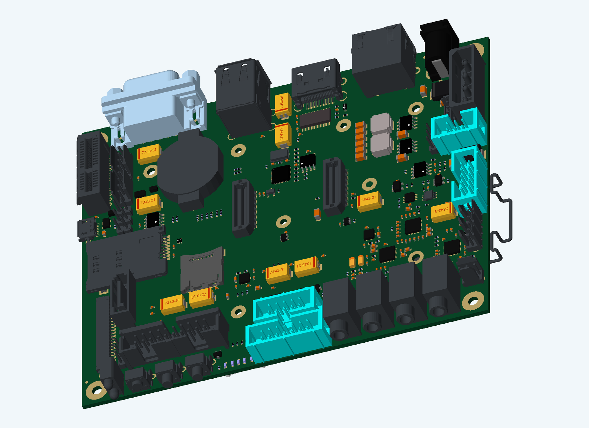

# Development Baseboard

A Development Baseboard recebe o módulo iMX6 Rex, distribui a alimentação e disponibiliza interfaces de vídeo, rede, armazenamento, áudio e expansão.

| Característica | Especificação |
|---|---|
| Etapa do curso | L7-01 — Differential Pairs Fine Tuning |
| Dimensões | 135 × 110 mm |
| Camadas de cobre | 6 |
| Projeto Altium | `iMX6 Rex Development Baseboard V1I1.PrjPcb` |
| Layout | `iMX6 Rex Development Baseboard V1I1_PCB.PcbDoc` |

No Altium Designer, o arquivo `.PrjPcb` reúne os documentos do projeto. O `.PcbDoc` apresenta o posicionamento dos componentes, o roteamento e as camadas da placa.

[Funcionamento](../../docs/FUNCIONAMENTO.md) · [Galeria](../../Imagens/README.md) · [Lista de materiais](../../BoM/README.md)
