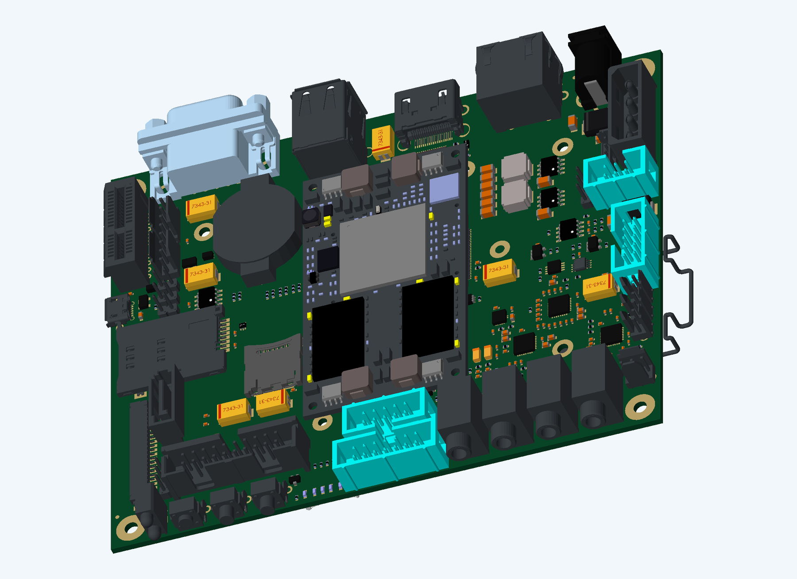
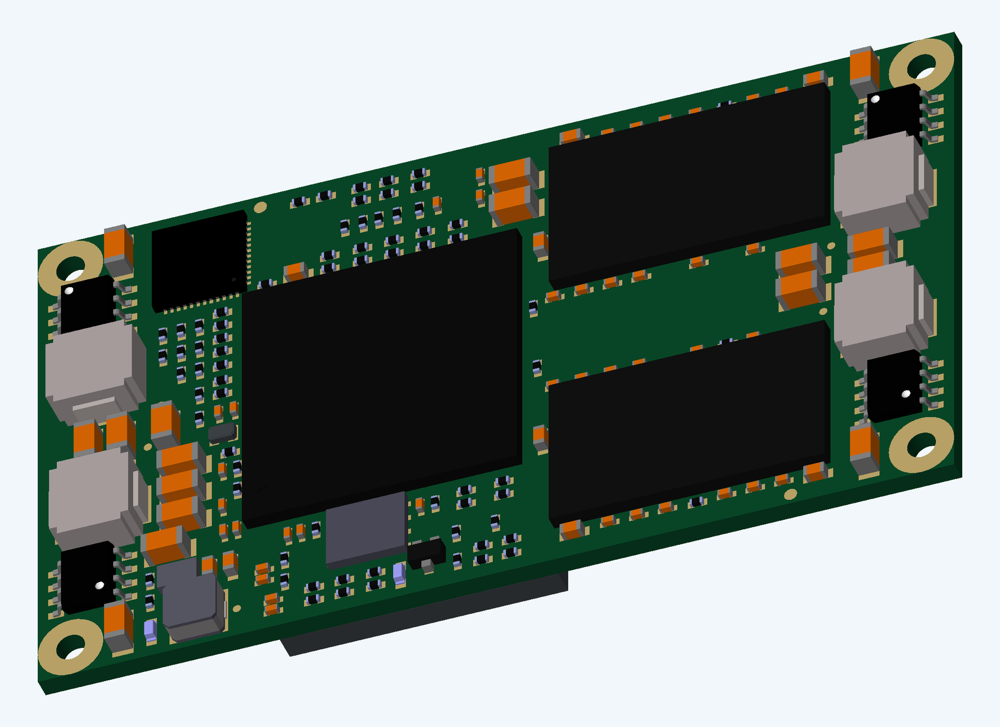
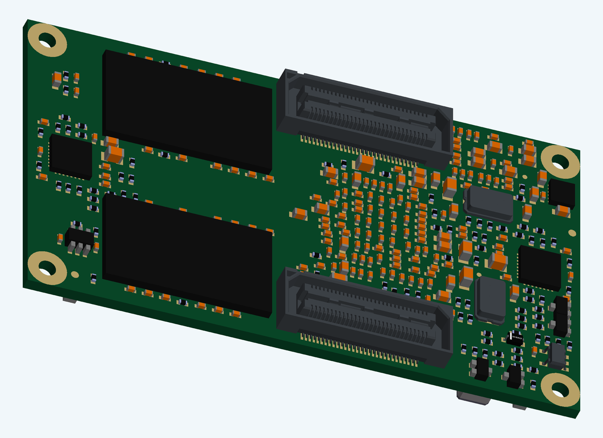
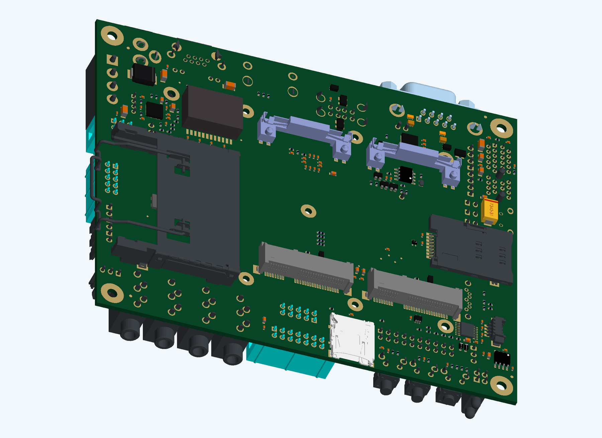
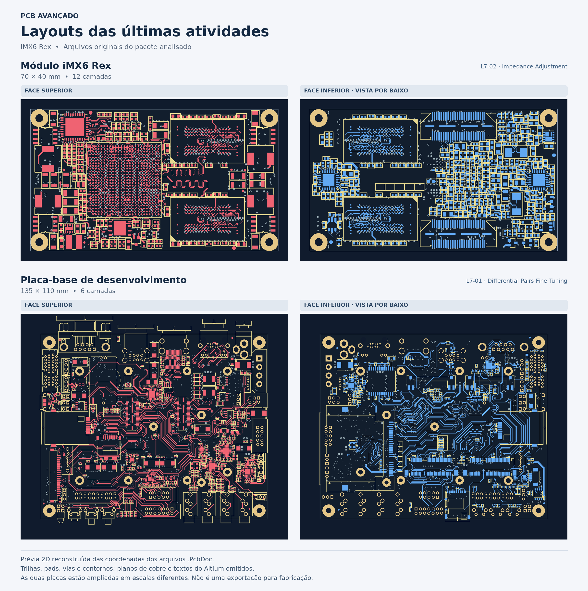

# PCB Avançado — iMX6 Rex

Projeto de estudo do curso **Advanced PCB Layout Course**, organizado por **CarloRenan**. A entrega reúne os arquivos finais disponíveis no material do curso, vistas 2D e 3D, lista de materiais (BOM) e a cotação da JLCPCB com a opção de montagem apresentada nas capturas.

*Vista mecânica do conjunto com o modelo do módulo incorporado à placa base. [Ver todas as vistas 3D e 2D](PCB_Avancado/Imagens/README.md).*

**Acesso rápido:** [Como o circuito funciona](PCB_Avancado/docs/FUNCIONAMENTO.md) · [Arquivos Altium](PCB_Avancado/Projetos/) · [BOM em Excel](PCB_Avancado/BoM/BOM_e_Cotacao.xlsx) · [Cotação JLCPCB](PCB_Avancado/Cotacao/README.md)

## O que essas placas fazem?

O conjunto forma uma plataforma de computação embarcada. O **módulo iMX6 Rex** concentra o processador, a memória e circuitos essenciais. A **Development Baseboard** recebe esse módulo e disponibiliza alimentação, conectores e interfaces para periféricos.

| Parte | Função | Arquivo selecionado no curso |
|---|---|---|
| Módulo iMX6 Rex | Processamento com i.MX6 Quad, memória DDR3, flash e interface Ethernet | L7-02 — Impedance Adjustment |
| Development Baseboard | Conexão de vídeo, armazenamento, rede, USB, áudio e expansão | L7-01 — Differential Pairs Fine Tuning |

O módulo usa o processador **MCIMX6Q5EYM10AC**, quatro memórias **MT41J128M16HA-15E:D TR**, o PHY Ethernet **KSZ9021RN** e a flash **SST25VF016B-75-4I-QAF**. Os conectores J1/J2 interligam o módulo à base. A base possui circuitos e conectores para HDMI, LVDS, USB, Ethernet, SATA/CFast, PCIe, áudio, SD, UART e GPIO. O funcionamento de cada interface depende da montagem e do software usados.

Em uma aplicação, o conjunto pode executar software embarcado para uma interface com tela, comunicação em rede e controle de periféricos. A tarefa concreta depende do firmware e do sistema instalado.

Detalhes: [funcionamento e arquitetura](PCB_Avancado/docs/FUNCIONAMENTO.md).

## Vistas 3D das placas

| Módulo — face superior | Módulo — face inferior |
|---|---|
|  |  |

| Placa base — face superior | Placa base — face inferior |
|---|---|
|  |  |

As imagens usam os corpos 3D e os posicionamentos presentes nos arquivos Altium. Cores, acabamento e detalhes de cobre estão simplificados. A [galeria](PCB_Avancado/Imagens/README.md) explica a origem e o alcance dessas visualizações.

## Layout final disponível no curso

| Característica extraída do PCB | Módulo | Placa base |
|---|---:|---:|
| Dimensões | 70 × 40 mm | 135 × 110 mm |
| Camadas de cobre | 12 | 6 |
| Objetos de componente no PCB, incluindo auxiliares | 473 | 580 |
| Componentes com código de fabricante na BOM principal | 457 | 546 |

As prévias 2D foram reconstruídas a partir das coordenadas dos arquivos PCB. Exibem trilhas externas, pads, vias e contornos; não representam todos os planos de cobre nem todas as camadas. As faces inferiores são vistas por baixo e as duas placas não estão na mesma escala.

“Final” significa **última etapa encontrada no material fornecido**. Os arquivos não foram alterados nem certificados como prontos para fabricação. A conferência DRC e a definição da variante devem ser feitas no Altium.

## Arquivos da entrega

| Pasta / arquivo | Conteúdo |
|---|---|
| [Projetos](PCB_Avancado/Projetos/) | 51 arquivos originais: projetos Altium, PCBs, esquemáticos e arquivos auxiliares |
| [BoM](PCB_Avancado/BoM/) | Planilha Excel, BOMs em CSV, inventários completos e registros das variantes |
| [Cotacao](PCB_Avancado/Cotacao/) | Dois prints originais e resumo dos valores da JLCPCB |
| [Imagens](PCB_Avancado/Imagens/README.md) | 5 vistas 3D e 5 prévias 2D das placas |
| [Critérios da entrega](PCB_Avancado/docs/ENTREGA.md) | Requisitos informados pelo professor e situação de cada item |
| [Origem e integridade](PCB_Avancado/docs/ORIGEM.md) | Seleção dos arquivos, créditos e hashes SHA-256 |

## Cotação JLCPCB

| Item | Quantidade | Valor do item (USD) |
|---|---:|---:|
| PCB do módulo | 5 | US$ 510,03 |
| PCB da placa base | 5 | US$ 43,50 |
| Montagem da placa base, dois lados | 2 | US$ 330,53 |
| **Soma dos itens exibidos** | — | **US$ 884,06** |

O frete de **US$ 42,51** aparece na tela do módulo e foi registrado separadamente. Não há frete consolidado nem total de impostos demonstrado. A captura informa que **a montagem do módulo HDI está indisponível**. Portanto, a cotação de montagem mostrada é da **placa base**; ela não comprova a montagem das duas placas.

Veja [cotação, prazos e comprovantes](PCB_Avancado/Cotacao/README.md).

## Abrir no Altium Designer

1. Baixe ou clone este repositório.
2. Abra `PCB_Avancado/Projetos/Modulo_L7-02/iMX6 Rex_V1I1.PrjPcb` para o módulo.
3. Abra `PCB_Avancado/Projetos/Placa_base_L7-01/iMX6 Rex Development Baseboard V1I1.PrjPcb` para a base.
4. Abra o documento `.PcbDoc` dentro de cada projeto para examinar o layout e as camadas.
5. Para preparar fabricação/montagem, confirme a variante, compile o projeto, execute DRC e gere os arquivos de fabricação e de posicionamento no Altium.

As BOMs fornecidas são do **projeto base, sem aplicação da variante Prototype**. Consulte [como a BOM foi produzida](PCB_Avancado/BoM/README.md). Gerbers, arquivos de furação, pick-and-place e firmware executável não estavam no pacote final selecionado e não foram simulados como saídas de fabricação.

## Créditos

Projeto de referência **iMX6 Rex**, associado à FEDEVEL Academy. Os arquivos nativos e avisos existentes foram preservados. Este repositório documenta o estudo e a organização da entrega; não atribui a autoria original do circuito ao aluno nem adiciona uma licença aos materiais de terceiros.

Referências: [iMX6 Rex](https://sites.google.com/imx6rex.com/www/home) · [Development Baseboard](https://sites.google.com/imx6rex.com/www/application/imx6-development-board).
